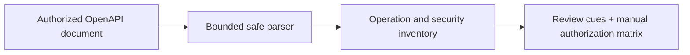

# Architecture and threat model

The CLI reads one explicitly supplied local OpenAPI file. A bounded JSON/YAML loader rejects duplicate keys and YAML aliases. The analyzer enumerates paths and operations, resolves only in-document security declarations, records unsupported references, and emits a JSON report. It does not follow servers, URLs, or `$ref` targets.

Threats include specification bombs, external-reference SSRF, false-positive vulnerability claims, and unauthorized active testing. Controls include a 4 MiB byte cap, YAML depth/node caps, no network capability, explicit `assessment_limit`, and language that distinguishes specification assertions from runtime behavior. Future active testing must require a separately approved target scope and non-destructive case list.
